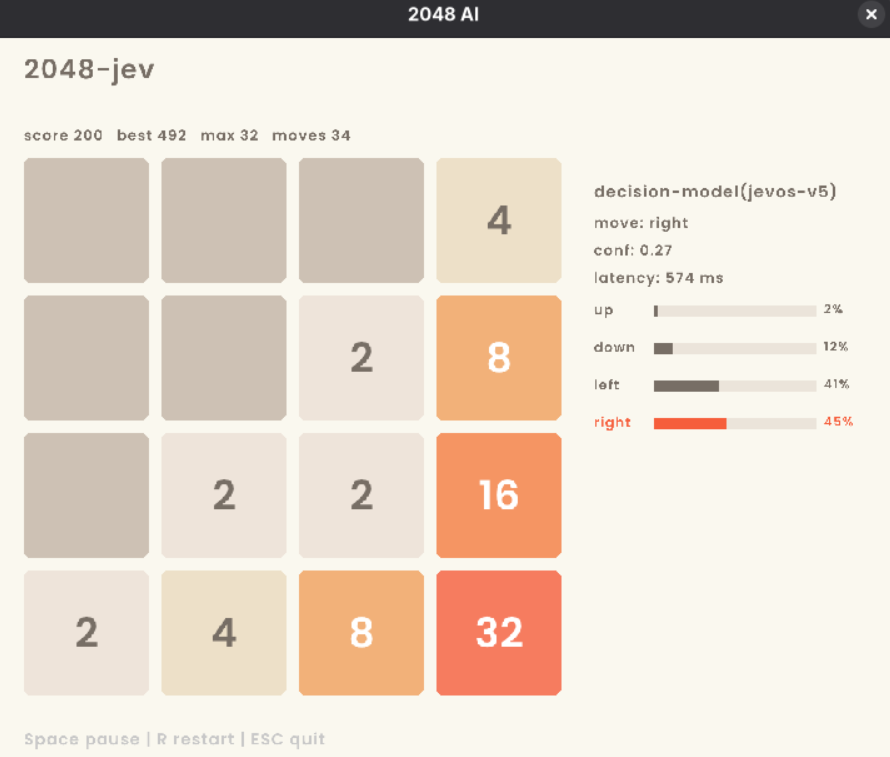

# ludica-jev

Game whose AI plays itself, built to study how far a text-based.

Games actually implemented: 2048

**decision model** (jevos, a local Jev-compatible model) gets on a game that a
real search AI (expectimax) can play well.



Two policies sit behind one `MovePolicy` interface:

| Policy | What it is | Status |
| --- | --- | --- |
| `expectimax` | the search ceiling | done |
| `decision_model` | jevos over HTTP, the mission | done |

For the *why* and the decisions, see [`docs/DECISIONS.md`](docs/DECISIONS.md).
For *how the code is arranged*, see [`docs/ARCHITECTURE.md`](docs/ARCHITECTURE.md).

## Results

Measured headlessly with `./build/bench` (30 games, decision-model prompt =
code-computed per-move consequences):

| Policy | Avg score | Median | Best tile | Wins |
| --- | --- | --- | --- | --- |
| `expectimax` (depth 3) | ~30,000 | — | 2048 | consistent |
| `decision_model` (jevos) | 946 | 916 | 256 | 0 / 30 |
| random (LMGame-Bench baseline) | 987 ± 414 | — | — | 0 |

The decision model scores ~950 — indistinguishable from the random baseline
(~990) and ~30× behind expectimax; its final tile peaks at 64–128 and never
reaches 512, with an average confidence of 0.41 and ~550 ms per decision. See
[`docs/FINDINGS.md`](docs/FINDINGS.md) for the full analysis: on a
numeric-planning game like 2048, code strictly dominates a text decision model,
and the gap is intrinsic to the model's lack of planning.

## Build

Requires CMake + a C++17 compiler and network for the first configure (it
fetches raylib and two header-only libs).

```bash
cmake -B build
cmake --build build
```

## Run

```bash
./build/ludica-jev            # expectimax plays (no dependencies)
./build/ludica-jev decision   # the decision model plays (needs jevos, see below)
```

Controls in the window: **Space** pauses, **R** restarts, **ESC** quits. The AI
auto-plays; you watch. A side panel shows the AI's decision — for the decision
model it also shows confidence, per-move probabilities, latency, and a fallback
flag. The game loads the bundled font `assets/Poppins.ttf`; run from the project
root so it is found (it falls back to the default font if missing).

### Running with the decision model

`./build/ludica-jev decision` talks to a local jevos server on
`127.0.0.1:8017`. If it isn't running, the game still works but falls back to
"first legal move" (poor play, no crash).

1. Install jevos once — from the
   [release](https://github.com/feder-cr/jev/releases/tag/jevos-v5), download
   `jev-linux-x64.tar.gz` and `jevos-v5-openvino-int8.zip`:

   ```bash
   tar -xzf jev-linux-x64.tar.gz
   cd jev
   unzip ../jevos-v5-openvino-int8.zip    # creates model/
   ```

2. Start the server:

   ```bash
   ./jev serve                            # listens on 127.0.0.1:8017
   ```

3. Run the game:

   ```bash
   ./build/ludica-jev decision
   ```

The model can be swapped (jevos → Laya → hosted Jev) by changing the base URL —
all three speak the same `/v1/systemone` wire format.

## Benchmark

Headless score comparison of the policies (no window; the decision model needs
`jev serve` running). The measured numbers from these runs are in **Results**
above.

```bash
./build/bench decision 30   # 30 games, decision model only
./build/bench both 10 4     # 10 games each, expectimax depth 4
./build/bench expectimax 50 # 50 games, expectimax only
```

Usage: `bench [policy] [games] [depth]`, where policy is `both` (default),
`decision`, or `expectimax`. Prints score mean/median/min/max, best tile, wins,
a final-tile histogram, and — for the decision model — latency, confidence, and
fallback count.
